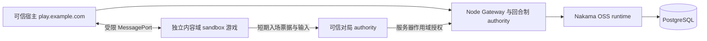

# Arcane 游戏公共平台：Nakama OSS + 可信宿主

这套代码把生成游戏的账号、存档、社交与比赛结算交给独立公共平台。Nakama OSS 3.41.0 负责账号基础与服务端 JavaScript runtime；`platform/nakama/runtime.template.js` 和 PostgreSQL 中的 `arcane_*` 表实现本项目的授权、作用域、好友、聊天、队伍、匹配、排行榜、成就、奖励账本与赛事规则。

生成游戏只使用固定的 `@arcane/game-sdk`。可信父页面保管 HttpOnly 登录会话和短期游戏授权，游戏在不含 `allow-same-origin` 的 sandbox iframe 内通过绑定窗口与随机 nonce 的 MessagePort 调用公共能力。浏览器中的游戏不持有 Nakama runtime key、发布凭据或服务器 workload token。



## 当前可用范围

| 能力 | 当前行为 |
| --- | --- |
| 账号与资料 | 游客会话、邮箱登录/新建账号、资料版本检查、退出撤销会话及关联游戏授权。新邮箱账号和游客身份分开，不自动绑定、合并或迁移数据。当前没有邮箱验证或找回密码 UI。 |
| 存档 | 游戏与环境隔离；使用版本号做并发更新检查。 |
| 好友与聊天 | 游戏内好友申请/接受/删除/屏蔽，公共、好友和队伍频道；宿主面板手动刷新，当前没有全局实时消息推送保证。 |
| Party | 每个游戏配置 1–10,000 人的社交队伍上限，创建时可选更小人数；默认 32 人。支持好友邀请或邀请码入队，成员和邀请分页，准备状态及总人数单独返回。 |
| 匹配 | 同游戏、环境、发行版本的个人排队；Party 不会自动一起排队。 |
| 多人玩法 | SDK/注册/匹配层支持清单配置 2–100 人；内置 `score-race-v1` 轻量反应竞速模板可覆盖该范围。双人取石使用 `turn-based-v1`，规则固定两人。新增玩法需可信服务端适配器。 |
| 排行榜/奖励 | 服务端验证的比赛结果推进排行榜、成就和只读金币账本；客户端不能提交任意分数或发奖。 |
| tournaments | 注册清单中配置时间窗、关联排行榜；玩家报名后按积分榜排名。当前没有淘汰赛签表或自动奖金结算。 |

游戏和环境隔离社交及玩家数据；发行版本绑定能力清单、玩法适配器与比赛票据。SDK 与 runtime 的完整参数见 [SDK API](../packages/game-sdk/API.md)、[runtime 契约](nakama/CONTRACT.md)。

## 按游戏配置人数

SDK 的通用容量与具体玩法容量分别校验。游戏在登记清单中选择人数，创建队伍时还可以再缩小；不能由未经授权的客户端越过清单限制。完整清单见 [容量配置示例](examples/configurable-capacity.manifest.json)。

```json
{
  "party": { "maxMembers": 10000 },
  "multiplayer": { "adapter": "score-race-v1", "minPlayers": 100, "maxPlayers": 100 }
}
```

| 层级/适配器 | 人数范围 | 配置含义 |
| --- | --- | --- |
| 公共 Party 状态 | 1–10,000；默认 32 | `manifest.party.maxMembers` 是游戏上限，`party.create({maxMembers})` 选择本队人数。 |
| 公共匹配/比赛登记与结算 | 2–100 | `multiplayer.minPlayers`/`maxPlayers`，同时受可信 adapter 的规则限制。 |
| `score-race-v1` | 2–100 | 内置反应竞速模板，服务器下发挑战、验证答案与节奏、计算名次。 |
| `turn-based-v1` | 固定 2 | 双人取石玩法的规则要求两人。 |

`minPlayers` 是组局触发人数，`maxPlayers` 是这一局的上限。例如 `2/100` 达到 2 人即可组局，不会等到 100 人；固定百人场配置 `100/100`。不同游戏可以使用同一 SDK，分别配置 2、4、20 或 100 人。队伍容量表示持久社交状态，不等于万人实时战斗或整队同时匹配。

`party.get({partyId,limit:100,cursor})` 每次最多读取 100 条。`memberCount`、`readyCount`、`maxMembers` 表示全队，`self` 始终包含本人状态，`cursor` 非空时继续翻页。不要用 `members.length` 当作全队人数，也不要让一万个客户端每帧轮询全队状态。成员页是实时视图，翻页期间人员变化不构成冻结快照。

```js
// 游戏清单已声明 party.maxMembers >= 128。
const { party } = await sdk.party.create({ maxMembers: 128, joinPolicy: 'code' });
// 队长通过可信的私密分享渠道提供 partyId / joinCode。
// 另一位玩家无需成为好友即可加入：
await anotherPlayerSdk.party.join({ partyId: party.partyId, joinCode: party.joinCode });
```

邀请码仅队长读取队伍时可见，普通成员和邀请摘要不返回它；持码者可以申请入队，服务端仍原子检查容量与“一人一队”。当前没有邀请码轮换接口，不要把邀请码写入公开日志。默认 `joinPolicy:'invite'` 继续使用队长好友邀请。

本地百人链路测试：保持本地服务运行，执行 `npm run platform:load:multiplayer -- 100`；也可将 `100` 换成 `2–100` 的任意整数。它为测试用户预置私有会话以避免放宽同 IP 注册限流，随后通过 SDK 公共匹配、票据、真实 WebSocket、输入和最终结算验证配置人数。脱敏报告写入 `.local-data/multiplayer-load-report.json`。万人队伍的数据库分页、容量与并发入队检查包含在 `platform:test:local`；数据量测试使用 SQL 创建大样本，不代表万人同时在线或万人完整邀请流程。

回合制默认双方连接后才开局，120 秒未到齐弃赛且不计奖，回合上限 60 秒。退出登录会撤销该宿主会话，比赛入场、输入及后台检查验证撤销状态；已有连接通常在约 5 秒的检查周期内处理，后台暂不可用时最多有 10 秒宽限，然后关闭。

## 先在本机运行

原生启动器支持以下组合，使用 Node.js 22+（推荐 Node.js 24 LTS）、npm 和系统 `tar`。下载按操作系统/架构选择官方 Nakama 3.41.0，校验代码中固定的 SHA-256；PostgreSQL 由对应平台的 `embedded-postgres` 包提供，无需另外安装数据库。

| 系统 | 原生架构 | 安装与运行条件 |
| --- | --- | --- |
| Windows 10/11 | x64 | PowerShell、Node.js；系统自带 `tar.exe`。 |
| macOS | Apple Silicon arm64、Intel x64 | Terminal、对应架构的 Node.js；以普通用户运行。 |
| Linux | x64、arm64 | glibc 发行版，例如 Ubuntu 22.04+/Debian 12+；`tar`、系统 C/C++ 运行库；以普通用户运行。Alpine/musl 使用下方 Docker 方案。 |

所有命令都在仓库根目录执行。首次安装允许 npm 的 optional dependencies 和依赖安装脚本，`embedded-postgres` 需要它们提供本机二进制及库链接；不要使用 `--omit=optional` 或 `--ignore-scripts`。更换操作系统/架构后重新安装依赖，不要复制另一个系统的 `node_modules` 或数据库目录。

### Windows 安装与启动

安装 [Node.js 24 LTS](https://nodejs.org/en/download)，打开新的 PowerShell：

```powershell
node --version
npm --version
npm ci
npm run platform:local
```

### macOS 安装与启动

安装对应芯片的 [Node.js 24 LTS](https://nodejs.org/en/download)，或在已经安装 Homebrew 的机器上执行：

```bash
brew install node@24
export PATH="$(brew --prefix node@24)/bin:$PATH"
node --version
npm ci
npm run platform:local
```

不要用 `sudo npm`。启动器会为解压后的 Nakama 设置执行权限，数据库用 UTF-8 和 `C` locale 初始化，不依赖系统已安装某个语言的 locale。

### Linux 安装与启动

先安装对应架构的 [Node.js 24 LTS](https://nodejs.org/en/download)。Ubuntu/Debian 的基础依赖示例：

```bash
sudo apt-get update
sudo apt-get install -y ca-certificates tar libstdc++6 zlib1g
node --version
npm ci
npm run platform:local
```

只有安装系统依赖需要管理员权限；`npm ci` 和 `platform:local` 以普通用户运行。PostgreSQL 不允许 root 运行，启动器会提前提示，不会自动创建系统用户。若发行版提示缺少共享库，用 `ldd` 检查报错的二进制，或使用 Docker 方案；不支持的平台/架构会给出明确错误。

打开双人取石 `http://127.0.0.1:7400/play/arcane-take-away`，或可配置 2–100 人的反应竞速 `http://127.0.0.1:7400/play/arcane-score-race`。反应竞速的本地种子允许创建最多 10,000 人的社交队伍；玩法人数与社交队伍容量分别配置。本仓库提供这两个独立示例，不依赖其他游戏项目或私有素材。两个独立浏览器身份可实际匹配，不同标签页共享同一个账号；测试时使用无痕窗口或不同浏览器。

启动器下载并校验官方 Nakama 3.41.0，启动独立 PostgreSQL（55442）、Nakama（7450/7451）与 Gateway（7400）。数据和随机凭据保存在已忽略的 `platform/.local-data/`，按 Ctrl+C 停止，重启保留数据。开发数据库仅保存在当前检出目录。

端口可通过 `ARCANE_PG_PORT`、`ARCANE_NAKAMA_PORT`、`ARCANE_PORT` 设置；Nakama 控制台使用其 API 端口加一，全部必须互不冲突。自定义端口会记入私有本机配置，下面的真实数据库测试读取该配置；smoke/浏览器工具读取同一私有配置中的公共地址。

### 三个系统的测试示例

保持启动终端运行，在另一个 PowerShell、macOS Terminal 或 Linux shell 中执行相同命令：

```bash
npm run sdk:test
npm run platform:test
npm run platform:test:local
npm run platform:smoke:party
npm run platform:load:multiplayer -- 100
npm run platform:smoke
npm run platform:browser-smoke
npm run platform:browser:score-race
```

前两项是独立单元测试，未配置时真实 SQL/Goja 用例会跳过。`platform:test:local` 读取 `.local-data/platform.env`，自动连接正在运行的隔离 PostgreSQL 与 Nakama，执行 SDK、平台、真实 SQL/Goja 和宿主桥接测试，不打印私有凭据。`platform:smoke:party` 另验证 SDK 经真实 Nakama 的邀请码、配置人数、分页和并发入队。它们会在开发库创建隔离的测试数据，不能用于生产库。

浏览器测试默认使用系统 Google Chrome 和 Playwright。没有安装 Chrome（例如 Linux arm64）时，可使用 Playwright Chromium：

```bash
npx playwright install chromium
npm run platform:browser-smoke -- --chromium
npm run platform:browser:score-race -- --chromium
```

Linux 若缺浏览器共享库，先按 [Playwright 系统依赖说明](https://playwright.dev/docs/browsers#install-system-dependencies) 执行 `npx playwright install-deps chromium`；该步骤可能请求管理员权限。浏览器验收在 headless 模式下覆盖电脑与手机视口。脱敏报告及截图放在 `platform/.local-data/`。smoke 和浏览器套件针对本仓库提供的取石、反应竞速及公共系统运行。

本次 Windows x64 已运行真实完整栈。macOS/Linux 已加入工件选择、摘要校验、普通用户/端口检查及启动路径的自动测试；当前开发机器无法实际运行这两种系统，尚未声称其原生全栈验收通过。部署到目标机器后请按上面的同一套命令复验。

## Docker 单机部署

Windows/macOS 可安装 Docker Desktop（Windows 使用 Linux containers/WSL2），Linux 安装 Docker Engine 和 Compose v2；可信运维机还需 Node.js 22+。运行 `docker version`、`docker compose version` 确认 Docker daemon 可用。以下单行命令可在 PowerShell、macOS Terminal、Linux shell 中执行，均从仓库根目录运行。此配置默认启动 PostgreSQL、Nakama、Gateway 和内置 authority；构建只要求本仓库提供的源码。

```bash
node platform/examples/init-production-env.mjs
```

该命令只在 `platform/.env` 不存在时创建文件，生成彼此独立的随机密钥和 Ed25519 密钥对，不打印密钥。先编辑域名与来源设置，再启动：

```bash
docker compose --env-file platform/.env -f platform/docker-compose.yml up -d --build
docker compose --env-file platform/.env -f platform/docker-compose.yml ps
curl --fail http://127.0.0.1:7400/v1/health
```

Windows PowerShell 可用 `Invoke-RestMethod http://127.0.0.1:7400/v1/health` 做同样的健康检查。Docker 中运行的是 Linux 容器，不会使用原生启动器的嵌入式数据库；不要同时绑定同一个 7400 端口。容器镜像是否提供目标 CPU 架构以其官方清单为准，遇到 `no matching manifest` 时使用受支持的 Linux amd64 主机；Apple Silicon 的 amd64 模拟会增加开销。当前环境没有 Docker CLI，本配置尚未做实际 Docker build/up 验收。

Dockerfile 从源码构建固定 SDK 和带 schema 的 runtime。它仅复制明确的源码路径；`Dockerfile.dockerignore` 不将 `.env`、本地数据库、私人票据或生成游戏目录放进构建上下文。空白 `.env.example` 不能直接启动，必须生成私有配置。不要将 `docker compose config` 的完整输出提交到日志或工单，因为其中会展开密钥。

Nakama 启动前执行其自身的 `migrate up`；公共平台 schema 在 runtime `InitModule` 中通过事务与 advisory lock 幂等初始化。数据库使用 PostgreSQL 16，UTF-8。Nakama 与数据库只连接内部 Docker 网络，未向公网发布 API、控制台或数据库端口。Gateway 只绑定 Docker 主机的 `127.0.0.1:7400`，由反向代理终止 TLS。

## 域名、代理与环境变量

先准备两个独立 origin，例如可信宿主 `https://play.example.com` 与内容域 `https://game-content.example.net`。宿主运行 `/play/:gameId`、账号表单、社区面板和 `/v1/*` API。内容域只托管不可变游戏资源；即使它可运行任意生成 JavaScript，也不会获得平台登录权限。发布时登记的 `entryUrl` 必须来自 `ARCANE_GAME_ORIGINS`，且不得与可信宿主重合。

内容域的 ES modules、纹理等资源应支持匿名 CORS，例如 `Access-Control-Allow-Origin: *`，以便 opaque sandbox 加载；参见 [静态内容 Nginx 示例](examples/content-nginx.conf)。这只适用于无凭据的公共资源，可信 API 的 Origin 白名单和 Cookie 策略保持独立。

| 配置 | 读取位置与用途 |
| --- | --- |
| `ARCANE_PUBLIC_URL` | 公共 HTTPS 宿主 URL；用于安全 Cookie 和公开 WebSocket 入口。后端到 Nakama 仍走内部 HTTP。 |
| `ARCANE_ALLOWED_ORIGINS` | 能创建宿主会话/引导游戏授权的确切 origin，逗号分隔，不带路径或末尾斜杠。只配置可信宿主和可信编辑器。 |
| `ARCANE_GAME_ORIGINS` | 不可信游戏文件的独立 HTTPS origin 白名单，逗号分隔；绝不能同时加入可信来源。 |
| `ARCANE_TRUSTED_PROXY_IPS` | 可选的单跳代理 TCP 来源 IP 白名单，确切 IP、逗号分隔，不支持 CIDR。匹配后才读取 `X-Forwarded-For` 最右侧地址用于限流；空配置完全忽略该头。 |
| `ARCANE_HOST_PORT` | 主机 loopback 监听端口，默认 7400；容器内始终为 7400。 |
| `NAKAMA_*` | Compose 的 Nakama 服务/内部 bridge 配置；`NAKAMA_URL` 在容器里固定为 `http://nakama:7350`。不要使用本机回环地址访问另一个容器。 |
| `ARCANE_GATEWAY_KEY` / `ARCANE_ADMIN_KEY` | Node 到 runtime 的公共/管理调用独立凭据，必须不同，至少 32 字符。 |
| `ARCANE_TOKEN_SECRET` | 宿主/游戏/服务器授权的 HMAC 签名密钥，至少 32 字符。 |
| `ARCANE_ADMIN_TOKEN` | 外部管理/发布根凭据，至少 32 字符，不等于 runtime admin key。 |
| `ARCANE_PUBLISHER_KEYS` | JSON，`publisherId` → 发布 token 的 SHA-256 摘要；不是明文 token。默认空映射。 |
| `ARCANE_MATCH_PRIVATE_KEY` | Base64 编码的 Ed25519 PKCS#8 PEM，只交给 Gateway 签发入场票据。 |
| `ARCANE_MATCH_PUBLIC_KEY` | 对应 Base64 SPKI PEM，供可选外部 authority 验签；Gateway 本身从私钥导出公钥。 |
| `ARCANE_ADAPTER_IDS` | Nakama runtime 的可信玩法 allowlist，默认生产配置为 `turn-based-v1,score-race-v1`。这不是自动加载任意脚本的地址列表。 |

生产 Compose 固定 `ARCANE_LOCAL_DEVELOPMENT=false`。各系统的 `npm run platform:local` 都是独立本地开发工具，会生成自己的 `.local-data`、本地数据库和开发发行版本；不要把其开发地址、密钥或数据目录当作生产配置复制。

反代示例见 [nginx.conf](examples/nginx.conf)。替换域名、证书路径与后端端口；保留 WebSocket Upgrade 和 `Origin`。代理必须使用 `$proxy_add_x_forwarded_for`，并将代理实际连入 Gateway 时的 TCP peer IP 填入 `ARCANE_TRUSTED_PROXY_IPS`。不要凭空填写公网客户端地址，也不要让客户端绕过代理直接访问 Gateway。未启用可信代理 IP 时，代理后的玩家会共用代理 IP 的 auth/bootstrap 限流桶。

编辑器或平台接入时可通过其同源 `/api/game-platform` 反代 Gateway；仓库提供 [Cloudflare Pages 代理示例](../functions/api/game-platform/[[path]].js)。当前 Cookie 为 host-only、HttpOnly、SameSite=Lax；仅将一个跨站编辑器 origin 加入白名单，不能保证浏览器允许它携带第三方 Cookie。内容域永远不承担此反代或可信账号页面。

## 登记与发布游戏

空数据库不会自动创建生产游戏。不可变资源上传到独立内容域后，再登记对应游戏、环境、发行版本、构建摘要与能力清单。`/play` 页面必须显式指定已激活的 `environment` 与 `releaseId`；当前页面默认值是开发用的 `development/dev`。

```bash
node --env-file=platform/.env platform/tools/register-game.mjs \
  --manifest platform/examples/take-away.manifest.json \
  --game-id arcane-take-away --environment production --release-id r1 \
  --build-hash YOUR_IMMUTABLE_BUILD_SHA256 --publisher-id your-publisher \
  --entry-url https://game-content.example.net/arcane-take-away/r1/game.html
node --env-file=platform/.env platform/tools/register-game.mjs activate \
  --game-id arcane-take-away --environment production --release-id r1 \
  --build-hash YOUR_IMMUTABLE_BUILD_SHA256
```

该例使用 `.env` 中的管理根凭据。给 CI 使用 publisher token 时，将其摘要配置到 `ARCANE_PUBLISHER_KEYS`，在 CI 中设置 `ARCANE_PUBLISH_TOKEN`，省略 `--publisher-id`；Gateway 根据 token 绑定发布者，客户端不能冒充其他 owner。

生产入口为 `https://play.example.com/play/arcane-take-away?environment=production&releaseId=r1`。回合制示例源码 `examples/take-away/game.html` 的 `/sdk/index.js` 是绝对引用；若将此示例放到内容域，需要同时在该域提供构建生成的 SDK 文件到 `/sdk/index.js`。实际生成游戏通常已内联固定 SDK。不要直接将可信宿主的 `/examples/...` 地址登记为生产游戏文件源。

操作 CLI 不会上传或校验静态文件。你的发行流程应先登记 `activate:false`，上传全部不可变资源，核对文件大小与 SHA-256，最后激活同一 `buildHash`。在上传或校验失败时保留旧稳定版本；不要让新入口指向尚未上传完的目录。更多参数见 [OPERATIONS.md](tools/OPERATIONS.md)。

## 扩展比赛 authority

内置 `turn-based-v1` 和 `score-race-v1` 由 Gateway 进程运行。其他玩法需要平台维护的可信服务端适配器；仅在能力清单中写一个 endpoint，不能把任意游戏代码变成可信服务器。适配器必须校验玩家身份、一次性票据和冻结名单，按规则验证输入，持久化版本化状态，并向 Gateway 提交不可变结果。

外部 authority 使用按游戏、环境、发行版、适配器和操作范围限制的短期 workload token。平台签名根密钥仅留在可信运维端。签发与轮换说明见 [OPERATIONS.md](tools/OPERATIONS.md)，服务端注册、状态 CAS、票据消耗和幂等结算见 [runtime 契约](nakama/CONTRACT.md)。本仓库不附带其他商业游戏、美术素材或物理模拟服务器；扩展适配器时还须实现并验证 Gateway 的可信注册与路由。

## 持久化、备份与升级

默认卷 `arcane-platform_postgres-data` 保存 Nakama 账号及全部公共系统数据。保持 Compose project name 一致；`docker compose down` 保留卷，`down -v` 会删除它。Gateway 本身无持久文件需求。不要为实时 authority 使用 `--scale gateway=2` ；当前没有分布式房间 ownership、自动迁移或多节点比赛调度。内置比赛状态和待结算结果已落库，可由单个 authority 重启后恢复、重试。

备份必须同时包含完整 PostgreSQL、私有 `.env`/签名密钥、已发布的不可变游戏资源。只备份排行榜或单独恢复奖励表会丢失身份映射、会话撤销、入场票据消耗记录、比赛版本和不可变奖励账本的一致性。

```bash
mkdir -p platform/backups
umask 077
docker compose --env-file platform/.env -f platform/docker-compose.yml \
  exec -T postgres pg_dump -U postgres -d arcane -Fc > platform/backups/arcane.dump
```

将备份加密复制到独立存储并设置保留周期。恢复演练应在隔离的新环境、新卷上先只启动 PostgreSQL，再把 dump 用 `pg_restore -U postgres -d arcane --exit-on-error` 导入空库，恢复对应密钥，最后启动 Nakama/Gateway 并检查账号、作用域、已消费票据、已结算比赛与幂等奖励；不要在在线库上试恢复。外部 authority 若有额外状态或 outbox，也需停写备份或使用一致快照。

升级前备份数据库与密钥，先在恢复环境验证 SDK/runtime/数据库兼容性；升级镜像使用同一持久卷，不重建用户库。轮换签名密钥会使原授权失效，需安排玩家重新登录及工作凭据更新。健康接口 `/v1/health` 会探测 Nakama；还应监控 PostgreSQL 容量、请求错误率、WebSocket 连接数、待结算 outbox/重试以及 workload 到期。它不是自动扩容或跨地域部署保证。

本目录提供部署资源，不会自行创建 DNS、申请证书、开公网端口或部署服务。开发与回归命令为 `npm run sdk:test`、`npm run platform:test`、`npm run platform:smoke`；smoke 使用本地已启动服务，生产检查需按已登记版本和独立玩家身份执行。
